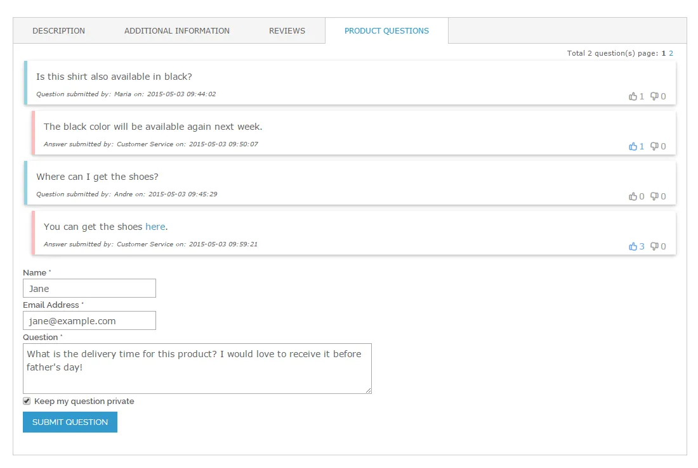
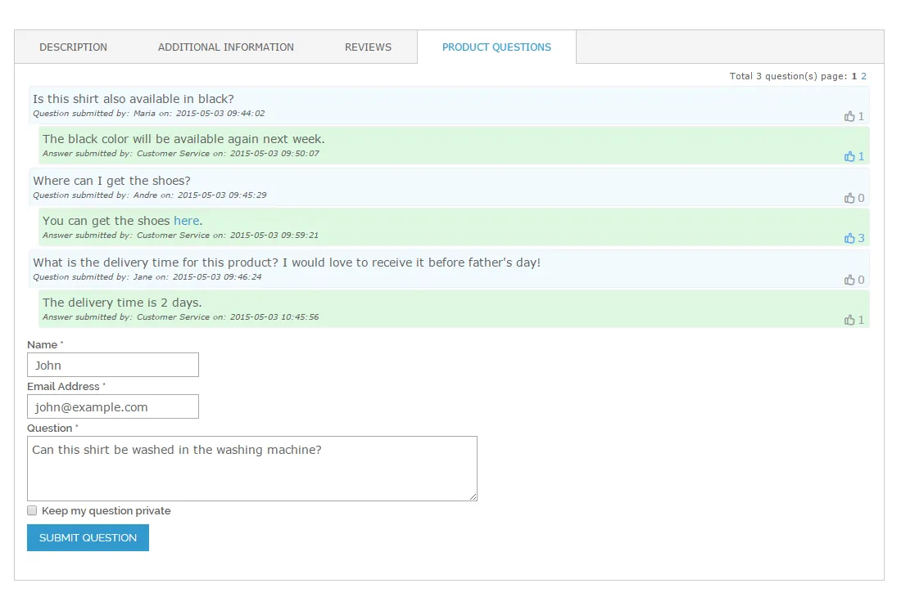
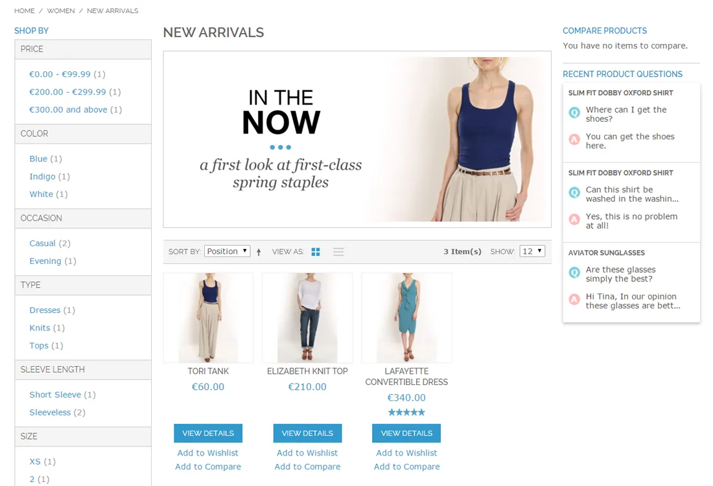
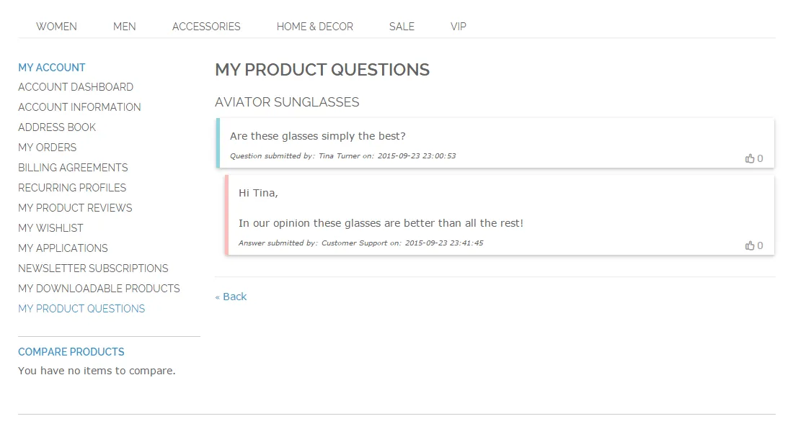
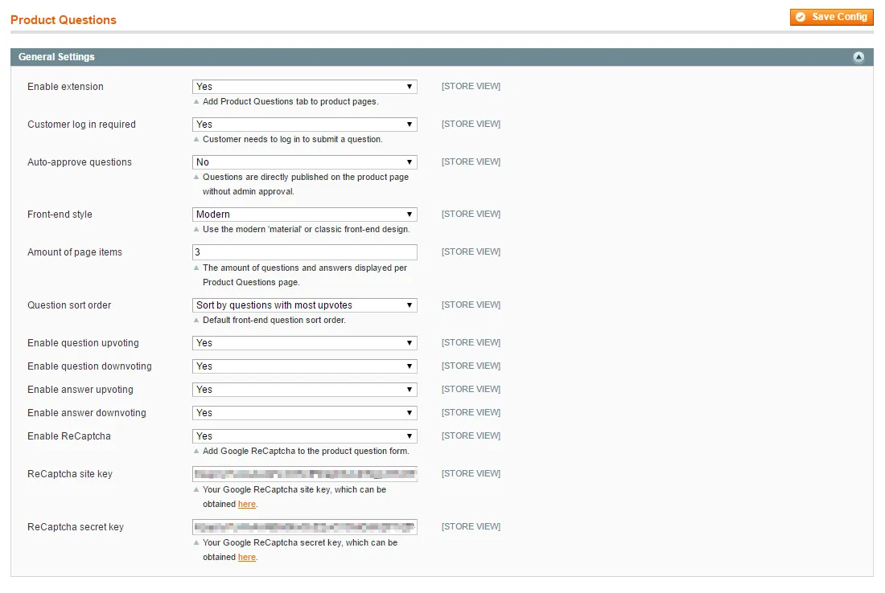
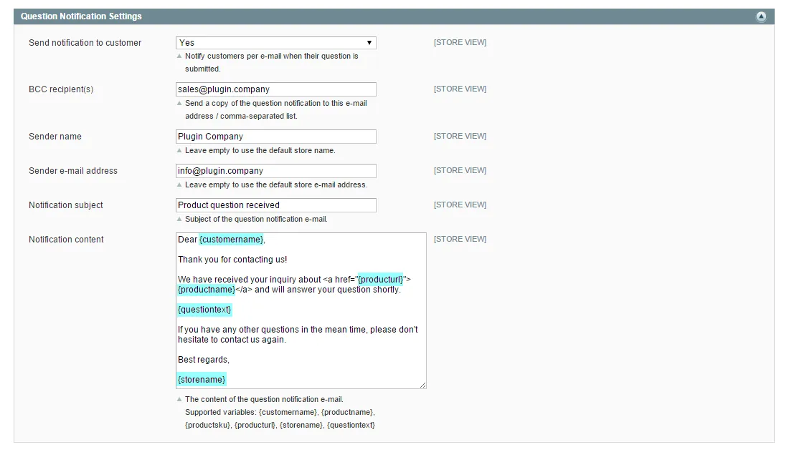
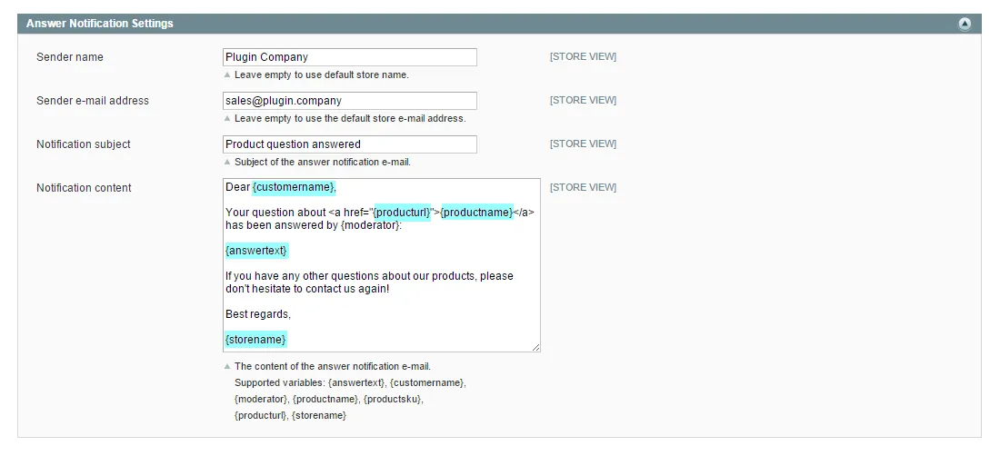

# Product Questions for Magento 1 / OpenMage

**Question and answer panel for Magento product pages.**



Adds a questions and answers panel to your product pages, where customers can ask questions about a product.

Questions are answered and moderated in the admin. Includes e-mail notifications and a product questions widget.

> [!NOTE]
> Product Questions is free and open source under the MIT License (since 2026). Plugin Company no longer actively develops this extension, but issues and pull requests are welcome.

## Features

### Front-end features

- Questions and answers panel on product pages
- Two responsive, AJAX-based designs
- Questions from guests and/or logged-in customers
- Google reCAPTCHA spam protection
- Optional up- and down-voting of questions and answers
- 'My Product Questions' tab in the customer account
- Product questions ticker widget

### Admin features

- Manage, approve and answer questions in the admin
- WYSIWYG editor for answers, with links and images
- Quick links to the product page in the storefront and admin
- Publish answers on the product page and/or e-mail the customer
- Customizable e-mail notifications with variables

## Screenshots

<table>
  <tr>
    <td width="50%" valign="top"><br><sub>Classic Product Questions panel design</sub></td>
    <td width="50%" valign="top"><br><sub>Product Questions ticker widget</sub></td>
  </tr>
  <tr>
    <td width="50%" valign="top"><br><sub>Product Questions in customer account</sub></td>
    <td width="50%" valign="top"><br><sub>Product Questions general settings</sub></td>
  </tr>
  <tr>
    <td width="50%" valign="top"><br><sub>Question e-mail notification settings</sub></td>
    <td width="50%" valign="top"><br><sub>Answer e-mail notification settings</sub></td>
  </tr>
</table>

More screenshots are on the [product page](https://plugin.company/magento1-extensions/product-questions.html).

## Compatibility

- **Magento:** Community Edition 1.4.x – 1.9.x, Enterprise Edition 1.8.x – 1.14.x
- **Latest version:** 1.6.0 (released 2019-09-20)
- **Composer package:** `plugincompany/magento1-product-questions`
- **Module:** `Plugincompany_Productquestions`

## Installation

### modman

```bash
cd /path/to/magento
modman init   # once per Magento installation
modman clone https://github.com/PluginCompany/magento1-product-questions.git
```

modman creates symlinks, so enable *Allow Symlinks* under System > Configuration > Advanced > Developer > Template Settings.

### Composer

With [magento-hackathon/magento-composer-installer](https://github.com/Cotya/magento-composer-installer) (it reads the `modman` file of this repository):

```bash
composer config repositories.plugin.company composer https://plugin.company/
composer require plugincompany/magento1-product-questions
```

Your project `composer.json` needs the Magento root directory in its `extra` section (and, with Composer 2.2+, the installer plugin allowed), for example:

```json
{
    "extra": { "magento-root-dir": "./" },
    "config": { "allow-plugins": { "magento-hackathon/magento-composer-installer": true } }
}
```

### Manual installation

Download the ZIP of the latest release from the [tags page](https://github.com/PluginCompany/magento1-product-questions/tags) ([1.6.0](https://github.com/PluginCompany/magento1-product-questions/archive/refs/tags/1.6.0.zip)) and copy the `app/`, `js/`, `skin/` folders into your Magento root:

```bash
unzip magento1-product-questions-1.6.0.zip
cp -R magento1-product-questions-1.6.0/app magento1-product-questions-1.6.0/js magento1-product-questions-1.6.0/skin /path/to/magento/
```

Step-by-step instructions are in the [installation guide](docs/02-installing-the-magento-extension.md).

### After installing

Clear the cache (System > Cache Management, or `rm -rf var/cache/*`), then log out of the admin and log in again so the new configuration sections and permissions are loaded.

### Upgrading from a purchased copy

Replace the old files with this release. No license key is needed; your settings and data stay as they are.

## Documentation

- [Documentation in this repository](docs/README.md) (Installation Guide, User Manual, FAQ, Tutorials)
- Online documentation: <https://plugin.company/knowledge-base/docs/magento-product-questions/>
- Product page: <https://plugin.company/magento1-extensions/product-questions.html>

## Changelog

See [CHANGELOG.md](CHANGELOG.md) for the release history.

## Contributing

Found a bug or have an improvement? Please open an [issue](https://github.com/PluginCompany/magento1-product-questions/issues) or send a [pull request](https://github.com/PluginCompany/magento1-product-questions/pulls). Since the extension is no longer actively developed by Plugin Company, fixes from the community are the best way to keep it working on current Magento 1 / OpenMage and PHP versions.

## License

Plugin Company's code in this repository is released under the [MIT License](LICENSE), Copyright (c) 2014-2026 Plugin Company.

Bundled third-party libraries keep their own licenses; see [THIRD-PARTY-NOTICES.md](THIRD-PARTY-NOTICES.md) for the full list.

In particular:

- **jQuery Advanced News Ticker** (`js/plugincompany/productquestions/jquery.newsTicker.js`) is licensed under **GPL-2.0** (upstream LICENSE; not stated in file), not MIT.
- The license of some bundled files could not be determined or verified (Fontello-generated icon font "updown").
