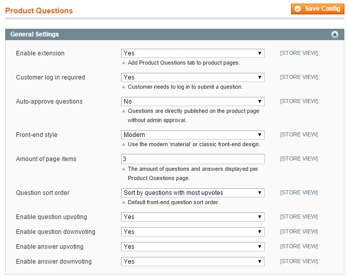
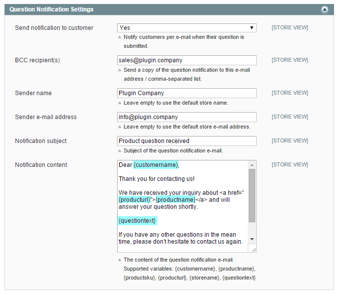
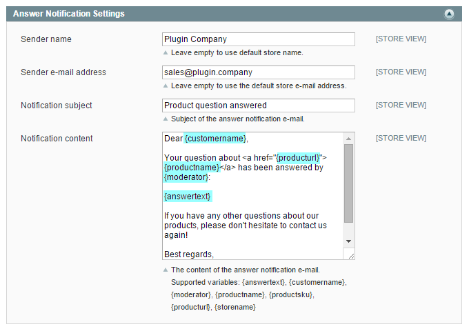

# Configuring the Product Questions Extension

To configure the extension, navigate to **System > Configuration** in the top Admin Panel menu and select **Product Questions** from the left side menu.

In the Product Questions config screen you can modify the extension's general settings and the question and answer notification settings as further explained below.

It’s possible to configure the extension per store view by changing the ‘Current Configuration Scope’ at the top left corner of the page.

To save any changes made in the Product Questions settings, click the ‘Save Config’ button in the top right corner of the configuration page.

## General Settings

In the General Settings you can:

- Enable the extension, adding a Product Questions tab to all product pages.
- Require customers to log in order to submit questions.
- Enable the question auto-approve option. If set to 'No', submitted questions need to be approved by a moderator first before they are published on the front-end product page (see the chapter about [answering product questions](./05-managing-product-questions.md#answering)).
- Select the front-end style of the Product Questions panel, choosing between the Modern 'material' design or the Classic design (see [front-end examples](./07-product-questions-frontend-examples.md)).
- Define the amount of questions and answers displayed per Product Questions page.
- Select the front-end sort order of submitted product questions.
- Enable the upvoting and downvoting function for front-end questions and/or answers.
- Enable ReCaptcha spam protection for the front-end product question form. Please note that ReCaptcha will only work after entering your site and secret keys below.

## Question Notification Settings

In the Question Notification Settings you can:

- Configure the e-mail notification that can be send to the customer and/or admin user when a new product question has been submitted.
- Enter a custom notification sender name and e-mail address. If these fields are left empty the default store name and e-mail address will be used.
- Customize the notification subject and content which support the use of the custom variables that are listed under the content area. The variables can be used to automatically include product question related data in the notification such as the product name, product page URL or a copy of the submitted product question.

## Answer Notification Settings

In the Answer Notification Settings you can:

- Configure the e-mail notification that can be optionally send to the customer and/or admin user when a product questions has been answered. Whether or not a customer receives the answer to his question by e-mail can be defined per question (see the chapter about [answering product questions](./05-managing-product-questions.md#answering)).
- Enter a custom notification sender name and e-mail address. If these fields are left empty the default store name and e-mail address will be used.
- Customize the notification subject and content which support the use of the custom variables that are listed under the content area. The variables can be used to automatically include product question related data in the notification such as the product name, product page URL or the answer to the submitted product question.

---

[Documentation index](./README.md) · [README](../README.md) · [Online version](https://plugin.company/knowledge-base/docs/magento-product-questions/user-manual/configuring-the-product-questions-extension/)
