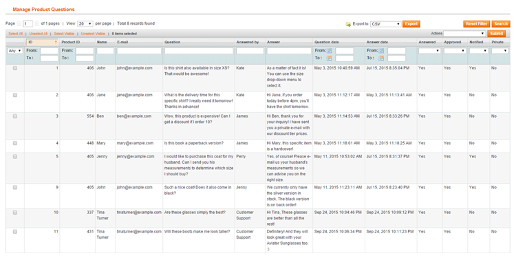
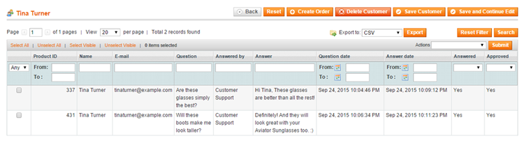
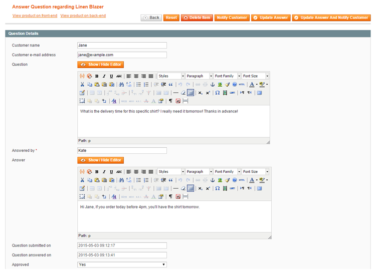

# Managing Product Questions

Submitted product questions can managed by navigating to **Catalog > Product Questions** in the top Admin Panel menu.

Select a product question from the list to modify or answer it.

Alternatively, submitted questions can also be managed per customer in the Product Questions tab of the customer view (**Customers > Manage Customers**).

Logged in customers can view their product questions and answers in the [My Product Questions](./07-product-questions-frontend-examples.md#my-product-questions) tab of their front-end customer account.

## Answering Product Questions

By selecting an item from the Product Questions grid you can:

- Review and modify the customer's name, e-mail address and submitted product question.
- Answer and approve the product question. Questions are only published on the front-end product page once they are approved, unless the auto-approve option is enabled in the extension's [General Settings](./04-configuring-the-product-questions-extension.md#general).
- Enable the WYSIWYG text editor and include links and images in the question and answer content.
- Use the quick-view links at the top of the page to view the product details in the front- and back-end.
- Use the buttons at the top of the page to post or update the answer on the product page, notify the customer by e-mail, or both. The e-mail notification content can configured in the extension's [Answer Notification Settings](./04-configuring-the-product-questions-extension.md#answer-notification).

---

[Documentation index](./README.md) · [README](../README.md) · [Online version](https://plugin.company/knowledge-base/docs/magento-product-questions/user-manual/managing-product-questions/)
