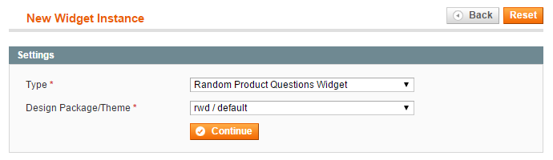
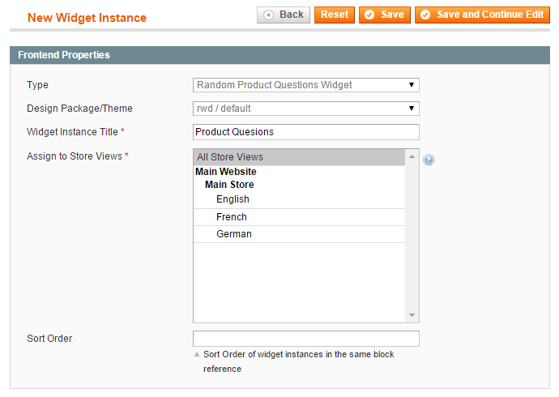
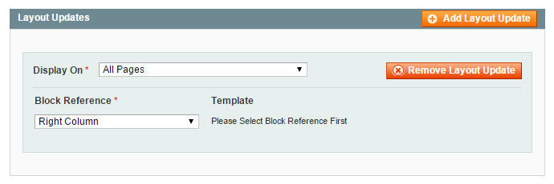
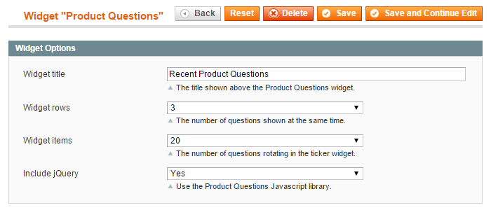

# Creating a Product Questions Widget

The extension includes a [Product Questions ticker widget](./07-product-questions-frontend-examples.md#widget-example) which can be used to rotate random product questions in the front-end Magento store. The questions and answers displayed in the widget include a direct link to the product page.

To create a Product Questions widget, navigate to **CMS > Widgets** in the top Admin Panel menu and click the 'Add New Widget Instance' button.

Select the widget type 'Random Product Questions Widget', choose your store's Design Package/Theme and click 'Continue'.

Enter a widget title for admin reference in the Frontend Properties tab and select the store view(s) in which the widget should be enabled, then scroll down to the Layout Updates section.

Click the 'Add Layout Update' button to define where you want to display the Product Questions widget, for example in the right column of all store pages.

## Widget Options

In the Widget Options tab you can:

- Enter a widget title which will be shown at the top of the Product Questions widget.
- Set the number of widget rows, which defines the amount of questions shown at the same time.
- Set the number of widget items, which defines the amount of questions and answers rotating in the ticker widget.
- Choose to use the extension's Javascript library if your store theme doesn't include jQuery.

Save the widget and **refresh the Magento cache** to show the Product Questions widget in the front-end store.

---

[Documentation index](./README.md) · [README](../README.md) · [Online version](https://plugin.company/knowledge-base/docs/magento-product-questions/user-manual/creating-a-product-questions-widget/)
