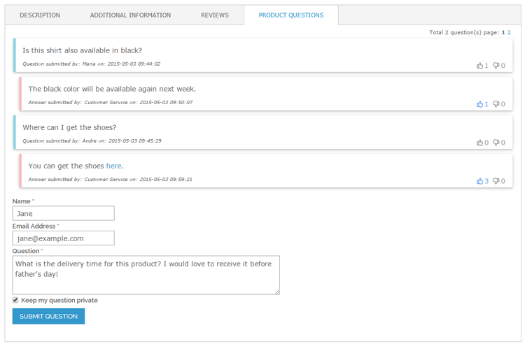
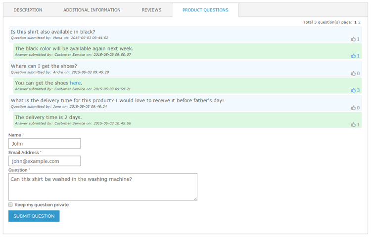
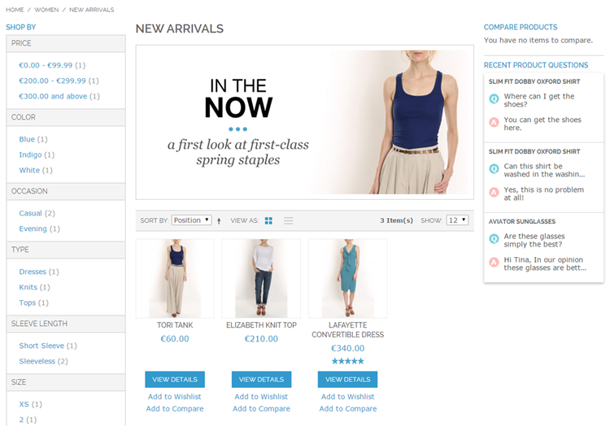
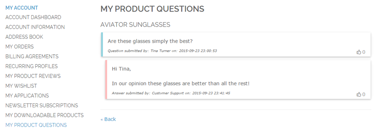

# Product Questions Front-end Examples

Below are front-end examples of the Product Questions panel, the Product Question ticker widget and the My Product Questions tab of the customer account.

## Product Questions on Product Page

Example of Product Questions panel on a product page with 'Modern' design and enabled up- and downvoting options.

Example of Product Questions panel with 'Classic' design and upvoting option.

Using the pagination in the top right corner of the panel the product question pages can be browsed through without refreshing the page.

If customers are logged in, their name and e-mail address are automatically prefilled in the Question form.

Customers can choose to keep their question private, in which case it won't be published on the front-end product page.

## Product Questions Widget

Example of [Product Questions widget](./06-creating-a-product-questions-widget.md) inserted in the right column of a category page.

## My Product Questions

If questions are submitted by logged in customers, they can view their questions and answers in the My Product Questions tab of the front-end customer account.

---

[Documentation index](./README.md) · [README](../README.md) · [Online version](https://plugin.company/knowledge-base/docs/magento-product-questions/user-manual/product-questions-frontend-examples/)
